<div align="center">

# RunButter

**The open-source company OS.** Sales · Finance · Marketing · Support · Projects · HR —
one Postgres database, and a copilot that works on the same records your team does.

[Website](https://runbutter.app) ·
[Documentation](https://runbutter.app/developers) ·
[Agents](https://runbutter.app/ai-agents) ·
[Roadmap](docs/roadmap.md) ·
[Discussions](https://github.com/RunButter/runbutter/discussions)

[](LICENSE)


[](https://github.com/RunButter/runbutter/stargazers)

</div>

<br />

<picture>
  <source media="(prefers-color-scheme: dark)" srcset="docs/images/readme/hero-dark.webp" />
  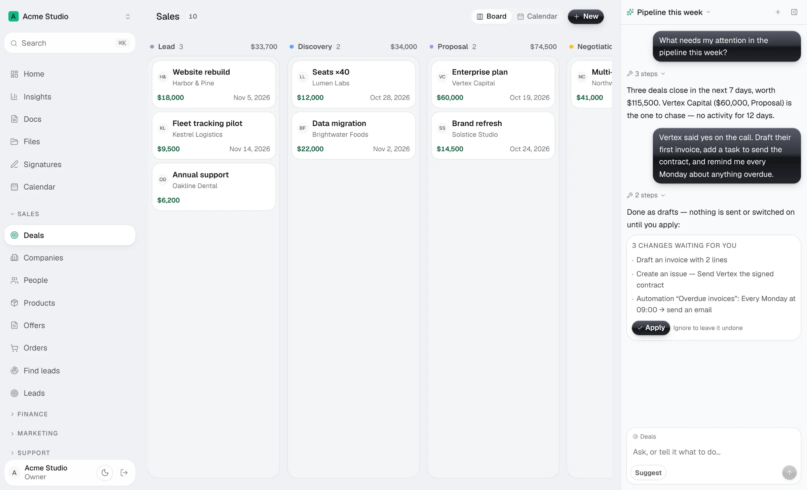
</picture>

<p align="center"><sub>Ask in plain words. The copilot reads the same records you see, and anything it wants to change waits for your <b>Apply</b>.</sub></p>

---

Most companies run a CRM, an accounting tool, a marketing tool, a help desk, a
project board, an ATS and a scheduling link — seven subscriptions that never
talk to each other, and an afternoon a month spent copying between them.

RunButter is one workspace where a company, a person, a deal, an invoice, a
chat, a project and a candidate are **connected records in one database**. That
is what makes "which clients who owe us money also booked a call this week" a
question you can ask instead of an afternoon.

**MIT licensed.** Fork it, sell it, run it. No open-core, no AGPL, no "community
edition" with the good parts removed.

## What it replaces

| Instead of… | RunButter has |
|---|---|
| HubSpot, Pipedrive | People, companies, a deals board and calendar, find leads, fill a company from its VAT number |
| Intercom, Crisp | A chat widget for your website and a shared inbox, with AI-drafted replies |
| Calendly | Booking pages with reminders, Meet links and the booking in your CRM |
| FreshBooks, Invoice Ninja | A4 invoices and offers with VAT, e-signatures, KSeF (PL), bank reconciliation |
| Expensify | Snap a receipt, check the fields, it is an expense |
| Mailchimp | Newsletters, segments, lead scoring and drip sequences |
| Buffer | A social calendar that publishes to LinkedIn and X |
| Typeform, Bitly, Plausible | Forms, short links and cookieless web analytics |
| Delighted | NPS and CSAT surveys filed on the customer |
| Greenhouse, Workable | An ATS with a careers page and Big-5 assessments |
| Harvest, Toggl | Timesheets that become invoices |
| BambooHR time off | Leave, allowances, approvals and public holidays |
| Notion, Google Sheets | Docs, checklists and sheets with 500+ formulas |
| Linear, Jira | Projects, issues, boards and a roadmap |
| Zapier | Automations, written as sentences |
| Slack, 1Password | Team chat and a vault the server cannot read |

One login, one database, one bill — or none, if you host it yourself.

## Quick start

```bash
npx create-runbutter
```

That checks your machine, clones, generates every secret, asks for a free Privy
app id and starts the containers. Open <http://localhost:3000>.

<details>
<summary>Or do it by hand</summary>

```bash
git clone https://github.com/RunButter/runbutter.git && cd runbutter
cp .env.docker.example .env
node scripts/gen-keys.mjs --write .env      # secrets, generated in place
#  ↳ paste a free Privy app id into .env (dashboard.privy.io, 2 minutes)
docker compose up
```

</details>

Postgres, PostgREST, storage, the whole schema and the app — five containers,
one command, no SQL pasted anywhere. Automations, reminders and scheduled agents
run on a built-in scheduler, so there is no cron to set up either.

Prefer hosted Postgres? `npm run migrate` applies the schema to any Supabase
project in one command. No terminal at all? Paste
[`supabase/schema.sql`](supabase/schema.sql) into the SQL editor. Full
instructions: **[docs/install.md](docs/install.md)**.

> Authentication is [Privy](https://privy.io) and it is hosted — free, two
> minutes, and there is no way around it in this stack, so it is said here
> rather than discovered halfway through. Everything else stays on your machine.

## A tour

<table>
<tr><td colspan="2"><h3>Sales</h3></td></tr>
<tr>
<td width="50%" valign="top">
<picture>
  <source media="(prefers-color-scheme: dark)" srcset="docs/images/readme/leads-dark.webp" />
  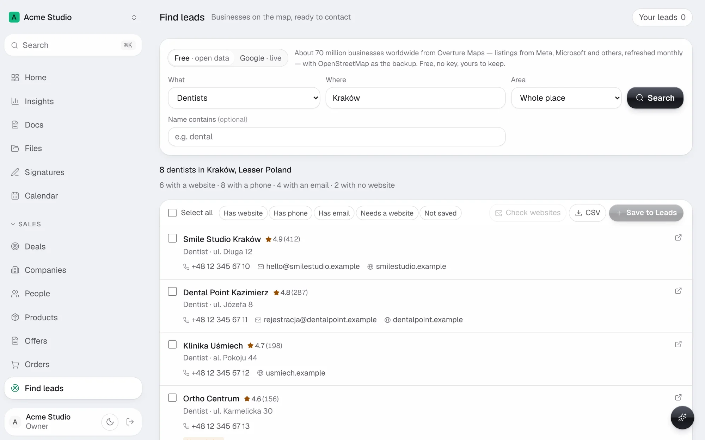
</picture>
<b>Find leads, free.</b> "Dentists in Kraków" → every one, with phone, website and often an email, from ~70 million businesses of open map data. Check their websites, save the good ones as Leads.
</td>
<td width="50%" valign="top">
<picture>
  <source media="(prefers-color-scheme: dark)" srcset="docs/images/readme/companies-dark.webp" />
  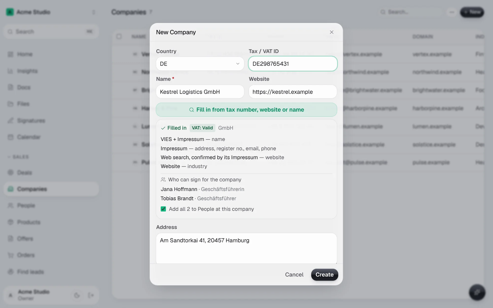
</picture>
<b>A company from its VAT number.</b> Type a tax number and the form fills itself from national registers and the company's own legal notice — address, register number, directors, website — and says where each field came from.
</td>
</tr>
<tr>
<td width="50%" valign="top">
<picture>
  <source media="(prefers-color-scheme: dark)" srcset="docs/images/readme/booking-dark.webp" />
  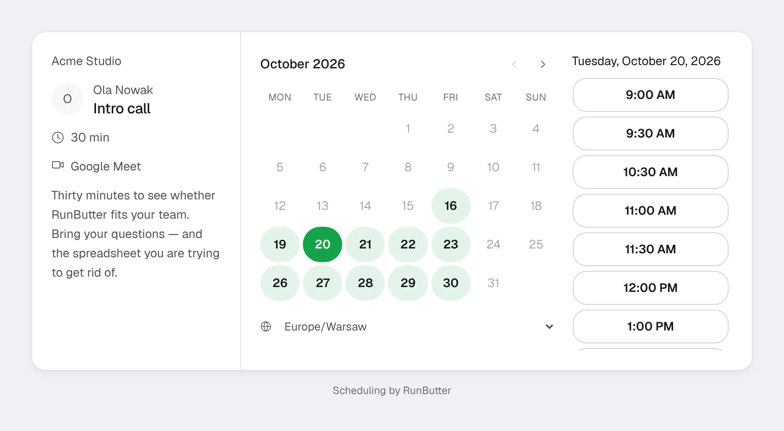
</picture>
<b>Booking pages, without Calendly.</b> Your hours, buffers and time off, a Google Meet link, reminders — and the person who booked lands in People, with a deal if you want one.
</td>
<td width="50%" valign="top">
<picture>
  <source media="(prefers-color-scheme: dark)" srcset="docs/images/readme/calendar-dark.webp" />
  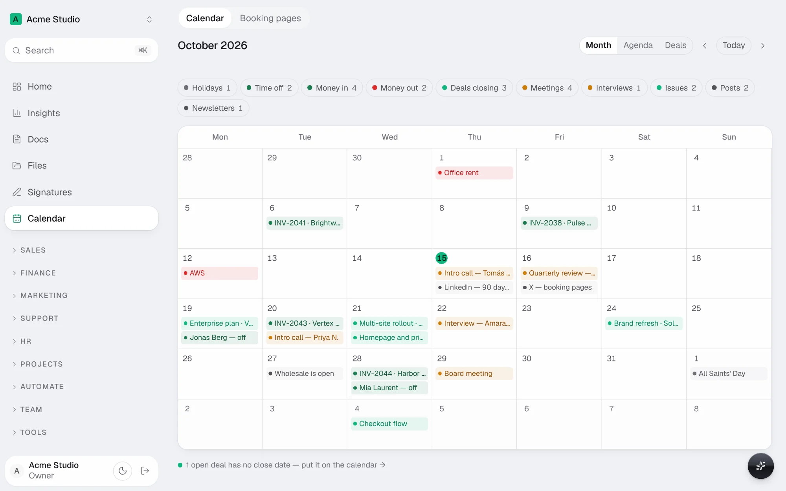
</picture>
<b>One calendar for the whole company.</b> Money in and out, deals closing, meetings, interviews, time off, holidays, posts and newsletters — each a filter, every item a link to its record.
</td>
</tr>
<tr><td colspan="2"><h3>Support</h3></td></tr>
<tr>
<td width="50%" valign="top">
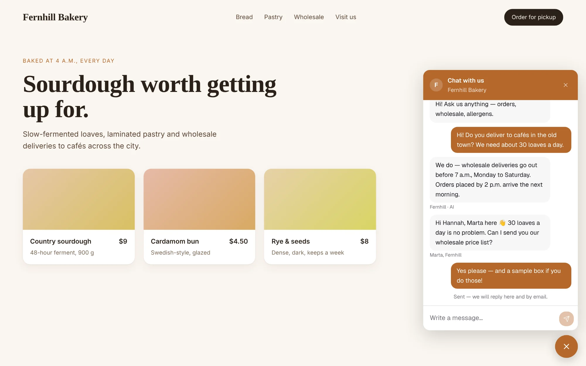
<b>A chat on your website — an Intercom alternative.</b> One script tag on your website or app. The chat runs in its own frame, so your page never holds the conversation; the visitor becomes a person in your CRM, and the bubble takes your colour.
</td>
<td width="50%" valign="top">
<picture>
  <source media="(prefers-color-scheme: dark)" srcset="docs/images/readme/inbox-dark.webp" />
  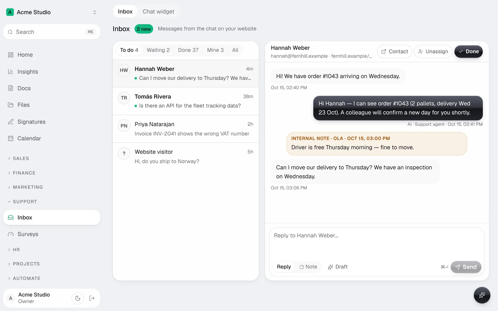
</picture>
<b>One inbox for the team.</b> To do, Waiting, Done — set by who spoke last, so nobody files anything. An agent can draft the first reply; internal notes never reach the customer.
</td>
</tr>
<tr>
<td width="50%" valign="top">
<picture>
  <source media="(prefers-color-scheme: dark)" srcset="docs/images/readme/survey-dark.webp" />
  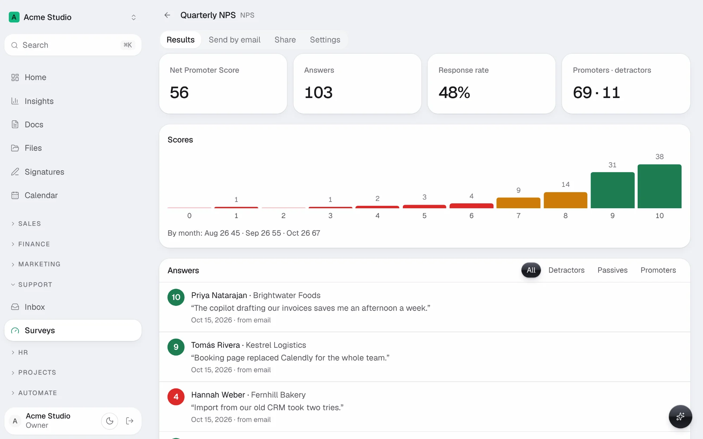
</picture>
<b>NPS and CSAT, answered in one tap.</b> The score is a link in the email; the answer is filed on the customer and their company; a detractor can fire an automation.
</td>
<td width="50%" valign="top">
<picture>
  <source media="(prefers-color-scheme: dark)" srcset="docs/images/readme/automations-dark.webp" />
  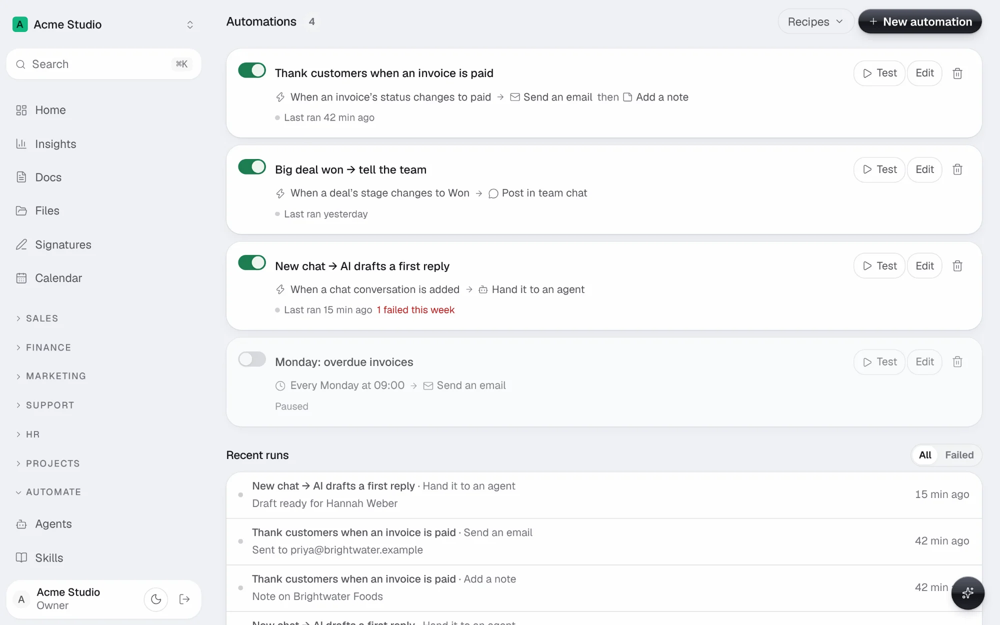
</picture>
<b>Automations you can read.</b> <i>When an invoice's status changes to paid → email them, then add a note.</i> Pickers, not JSON — and a Test button that really runs it.
</td>
</tr>
<tr><td colspan="2"><h3>Finance</h3></td></tr>
<tr>
<td width="50%" valign="top">
<picture>
  <source media="(prefers-color-scheme: dark)" srcset="docs/images/readme/finance-dark.webp" />
  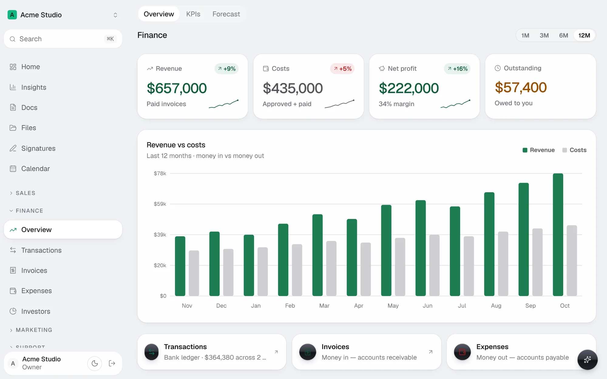
</picture>
<b>Finance that adds up by itself.</b> Invoices, expenses, a bank ledger with reconciliation, KPIs and a forecast. The dashboard is the invoices — there is no second copy to drift.
</td>
<td width="50%" valign="top">
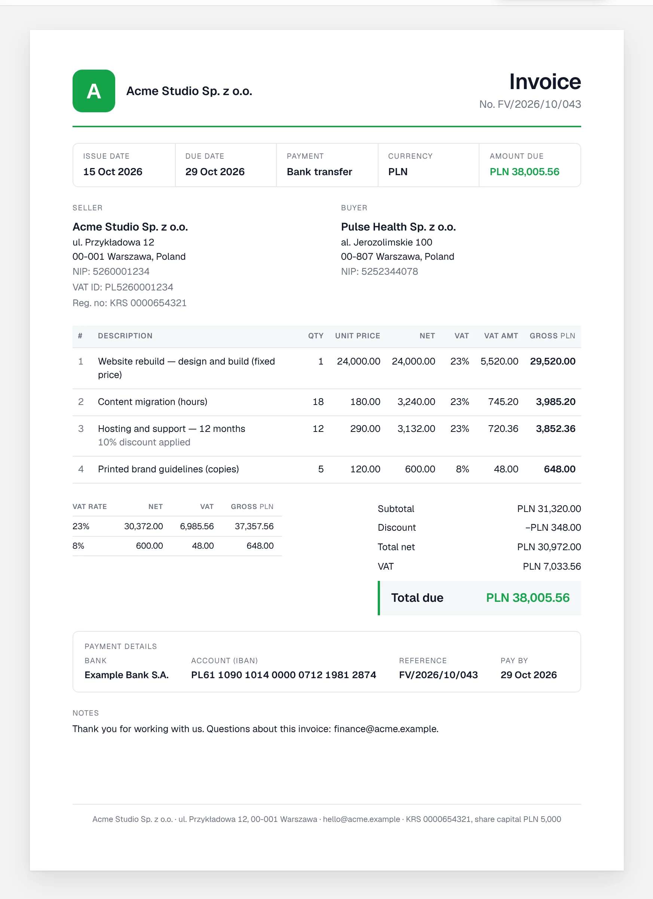
<b>Invoices that are real documents.</b> A4 on screen, on paper and in the emailed PDF. Net, VAT and gross per line, a summary per rate, NIP / VAT ID / KRS, IBAN and reference. KSeF XML for Poland.
</td>
</tr>
<tr>
<td width="50%" valign="top">
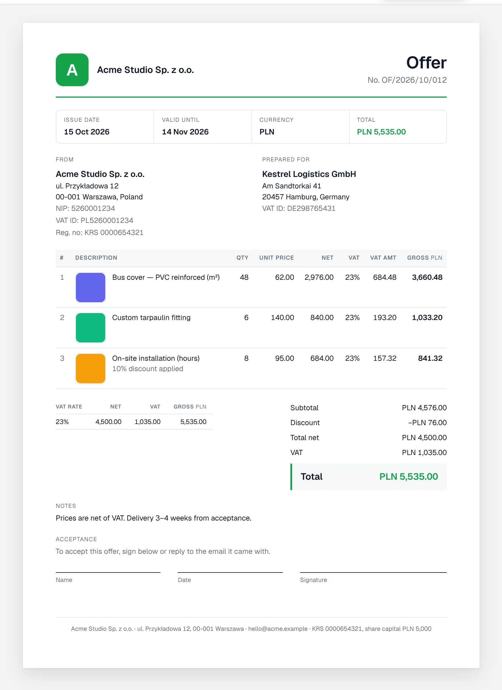
<b>Offers that turn into invoices.</b> Product pictures, a valid-until date and an acceptance block to sign. Accepted? One click makes it an invoice.
</td>
<td width="50%" valign="top">
<picture>
  <source media="(prefers-color-scheme: dark)" srcset="docs/images/readme/insights-dark.webp" />
  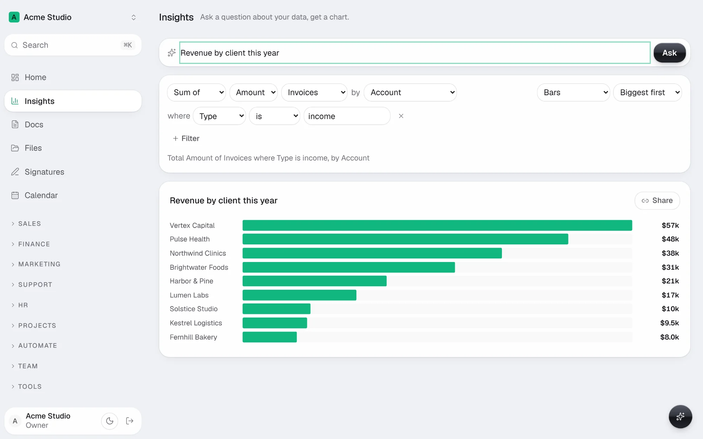
</picture>
<b>Ask a question, get a chart.</b> The AI fills in the query — every part of it a dropdown you can change, so it works with no AI key too. It never sees a record.
</td>
</tr>
<tr><td colspan="2"><h3>Marketing</h3></td></tr>
<tr>
<td width="50%" valign="top">
<picture>
  <source media="(prefers-color-scheme: dark)" srcset="docs/images/readme/newsletter-dark.webp" />
  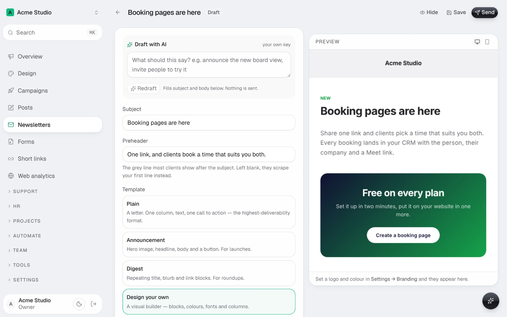
</picture>
<b>Newsletters, from blocks or drafted by AI.</b> Live segments, lead scoring, drip sequences, unsubscribe links and bounce handling — and a preview that is the email that goes out.
</td>
<td width="50%" valign="top">
<picture>
  <source media="(prefers-color-scheme: dark)" srcset="docs/images/readme/posts-dark.webp" />
  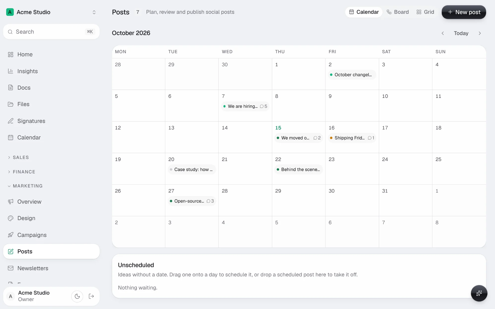
</picture>
<b>Social posts on a calendar.</b> Write, get a colleague's review, schedule to LinkedIn and X. Sending is at-most-once: a post never goes out twice.
</td>
</tr>
<tr><td colspan="2"><h3>HR</h3></td></tr>
<tr>
<td width="50%" valign="top">
<picture>
  <source media="(prefers-color-scheme: dark)" srcset="docs/images/readme/candidate-dark.webp" />
  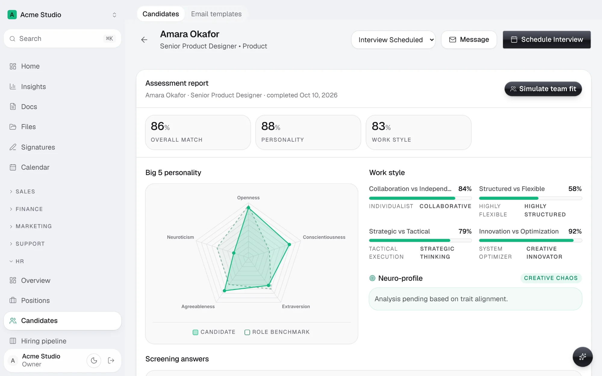
</picture>
<b>Hire by skills and personality.</b> A full ATS: positions, a careers page, Big-5 and work-style assessments against the role's benchmark, interviews on Google Calendar.
</td>
<td width="50%" valign="top">
<picture>
  <source media="(prefers-color-scheme: dark)" srcset="docs/images/readme/timeoff-dark.webp" />
  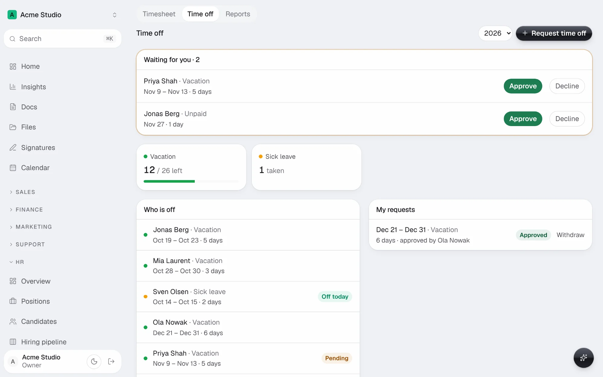
</picture>
<b>Time off, without a spreadsheet.</b> Allowances, approvals, public holidays for 19 countries, and a team view — sick leave stays private to the person and the admins.
</td>
</tr>
<tr>
<td width="50%" valign="top">
<picture>
  <source media="(prefers-color-scheme: dark)" srcset="docs/images/readme/time-dark.webp" />
  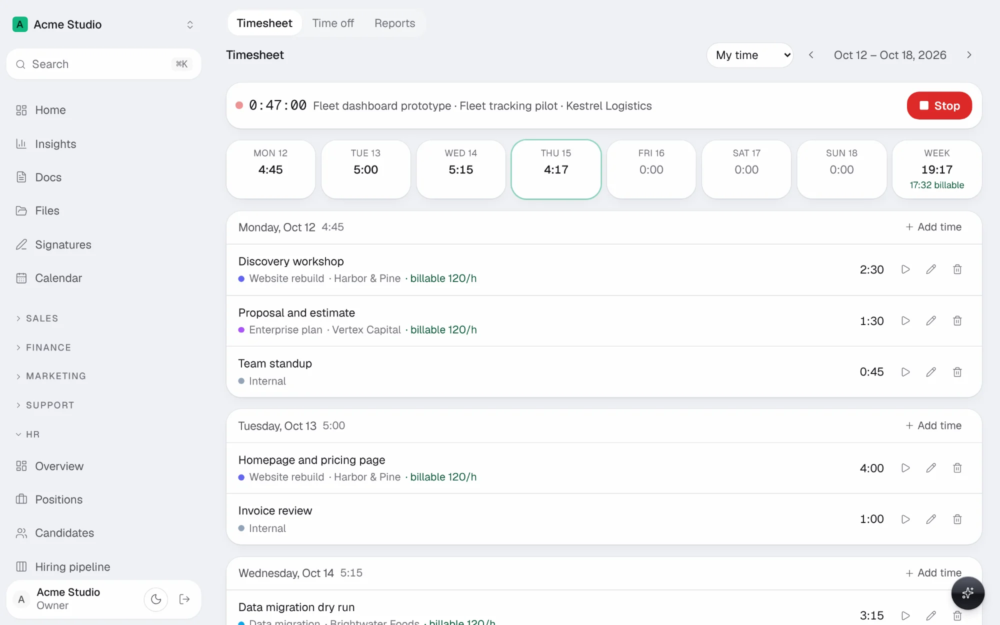
</picture>
<b>Time tracking that becomes an invoice.</b> A timer and a weekly timesheet; the billable hours become an invoice in one click.
</td>
<td width="50%" valign="top">
<picture>
  <source media="(prefers-color-scheme: dark)" srcset="docs/images/readme/sheet-dark.webp" />
  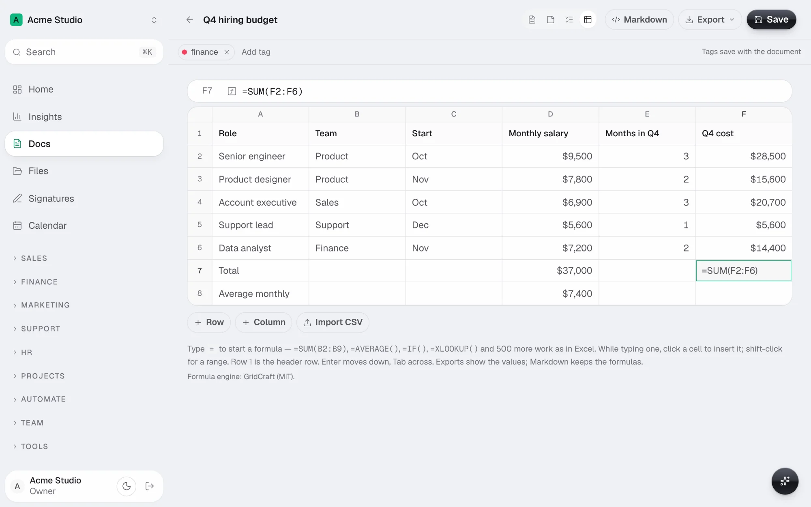
</picture>
<b>Docs, notes and sheets that calculate.</b> 500+ Excel functions in your browser, mail merge into one copy per customer, PDF and Word export without uploading.
</td>
</tr>
<tr><td colspan="2"><h3>Projects &amp; agents</h3></td></tr>
<tr>
<td width="50%" valign="top">
<picture>
  <source media="(prefers-color-scheme: dark)" srcset="docs/images/readme/roadmap-dark.webp" />
  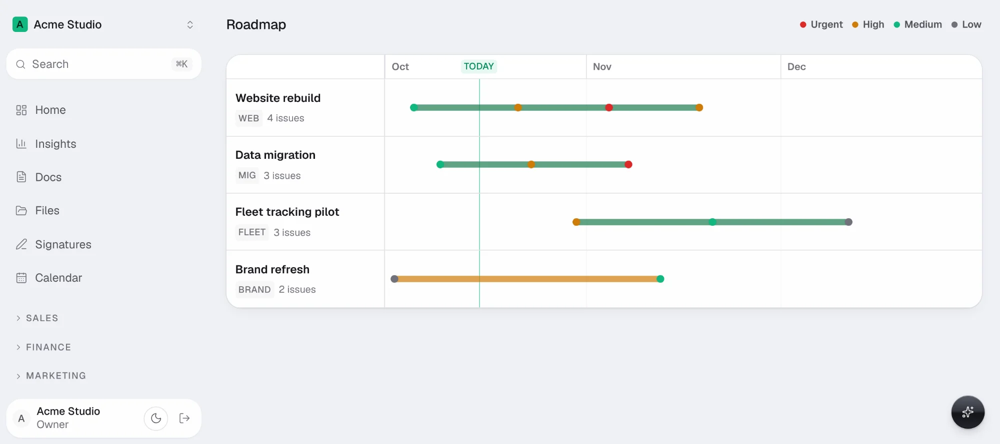
</picture>
<b>Projects, issues and a roadmap.</b> Boards and a timeline over the same issues, with time tracked against them.
</td>
<td width="50%" valign="top">
<picture>
  <source media="(prefers-color-scheme: dark)" srcset="docs/images/readme/agents-dark.webp" />
  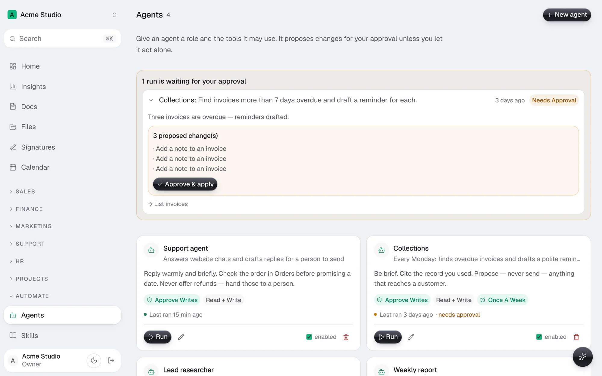
</picture>
<b>Agents that work while you don't.</b> Give one a role, tools and a schedule. It proposes; a person approves. Every run is a transcript you can read.
</td>
</tr>
</table>

## Everything in it

| | |
|---|---|
| **Copilot & agents** | A copilot beside every screen that reads and writes the same records you do, with suggest/auto per conversation. Agents with their own tools, skills and schedules. Every write is a proposal until a person approves it. The tool list is generated from [`lib/agents/catalog.ts`](lib/agents/catalog.ts) and published at [`/.well-known/mcp.json`](https://runbutter.app/.well-known/mcp.json) — read one of those rather than a number typed into a README |
| **Sales** | People and companies, a deals board and calendar, offers → invoices, products, orders, **find leads** from open map data or Google, **company lookup** by VAT number from national registers across Europe and beyond, **booking pages** |
| **Finance** | **A4 invoices and offers** (VAT per line and per rate, printable, the same PDF by email) and expenses, **scan a receipt** into an expense, a bank ledger with rule-based reconciliation, KPIs and forecast, cap table, branded PDFs, e-signatures, KSeF (PL) e-invoices, sanctions screening, IBAN checks |
| **Marketing** | Newsletters built from blocks or drafted by AI, live segments and lead scoring, drip sequences, a post studio that publishes to LinkedIn and X, forms, short links, cookieless web analytics, a **design spec** builder for your brand |
| **Support** | A **chat widget for your website or app** (an Intercom alternative) feeding a shared inbox, AI-drafted replies, **NPS and CSAT surveys** |
| **HR** | A full ATS: positions and a public careers page, candidate pipeline, Big-5 and work-style assessments, interviews via Google Calendar, onboarding, GDPR tooling. **Timesheets** and **time off** |
| **Projects** | Projects, issues, board, roadmap, mind maps |
| **Docs & files** | Documents, notes, checklists and **sheets with formulas**; mail merge; PDF/Word export in the browser; uploads are text-extracted and full-text searchable **next to the ledger** |
| **Automate** | When → only if → then, written as a sentence. Record changes, forms, chats, bookings, schedules and webhooks as triggers; email, chat, notes, AI, agents and signed webhooks as steps |
| **Team** | Team chat with channels, assets, and a password vault the server itself cannot read |
| **Integrations** | REST API, an MCP server (with OAuth, so claude.ai can connect), and Excel — a read-only CSV feed or a real two-way Microsoft Graph sync |
| **Anything else** | Custom objects: describe your business and get a workspace, or start from one of ten trade templates. Every object gets a table, a board, a calendar, CSV import, automations and agent tools the day you create it |

## Three things that make it different

**It costs nothing per query.** Search is Postgres full-text search. Matching,
reconciliation, segmentation and lead scoring are SQL. Leads come from Overture
Maps and OpenStreetMap; company details from public tax and business registers;
sanctions screening ingests the OFAC lists and matches them locally with
`pg_trgm`; public holidays are computed, not fetched; sheets calculate in
WebAssembly in your browser; PDF tools never upload. There is no meter under
the product.

**AI is bring-your-own-key.** Claude, OpenAI, Gemini, OpenRouter or any
OpenAI-compatible endpoint, added per workspace and sealed at rest. No
per-token markup, no "AI credits", no plan that rations how much thinking you
are allowed — and a usage report that shows every token, per feature.
→ [docs/agents.md](docs/agents.md)

**Agents are not a second security model.** Every tool call goes through the
same `SECURITY DEFINER` functions the UI uses, with tenancy derived in SQL —
so an agent cannot be talked into another workspace's data, because the query
never had access to it. Changing the shape of a workspace (a new object, an
automation, a member) is always a proposal, whatever the autonomy setting.
→ [docs/architecture.md](docs/architecture.md)

## Free tools, no account

All client-side, all MIT. Nothing uploads — they exist because they are useful,
and because they are the honest way to show what the rest is like.

| | |
|---|---|
| [**DESIGN.md builder**](https://runbutter.app/brand) | Upload a logo and a brand PDF, get the exact hex codes, type levels and rules out of them. Exports Google's [DESIGN.md](https://github.com/google-labs-code/design.md) format, Tailwind v4, CSS variables. |
| [**Style library**](https://runbutter.app/brand/library) | Complete design systems, free to copy into Claude Code, Cursor or Copilot. |
| [**Agent skill builder**](https://runbutter.app/plugins) | Write a skill, get a spec-conformant Agent Plugins 1.0 package. |
| [**PDF toolkit**](https://runbutter.app/pdf) | Merge, split, rotate, watermark, PDF→images, PDF→Markdown. The files never leave your machine. |
| [**Password generator**](https://runbutter.app/password) | Rejection-sampled, entropy shown, no network. |
| [**AI cost calculator**](https://runbutter.app/ai-cost) | What an agent actually costs to run, per model. |

<table>
<tr>
<td width="50%"><a href="https://runbutter.app/brand">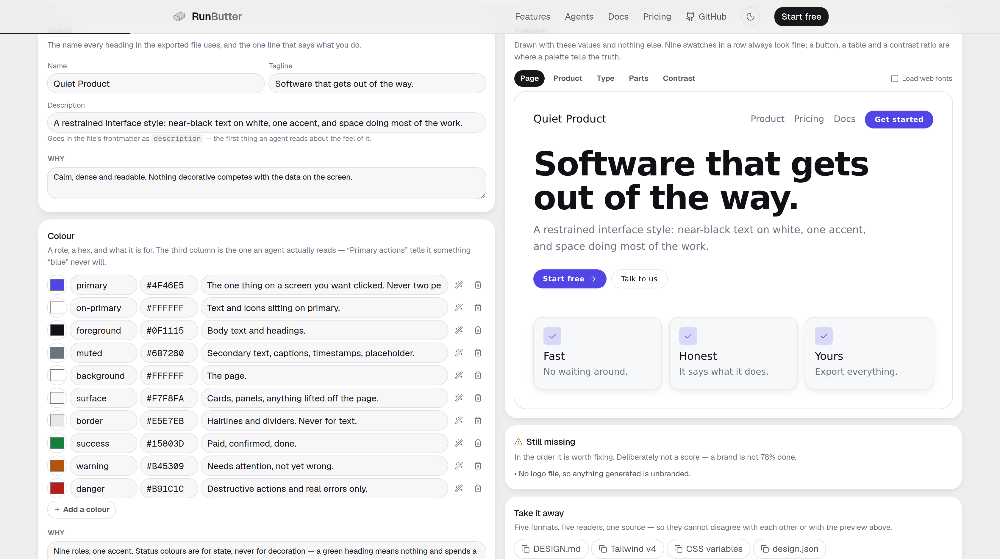</a></td>
<td width="50%"><a href="https://runbutter.app/plugins">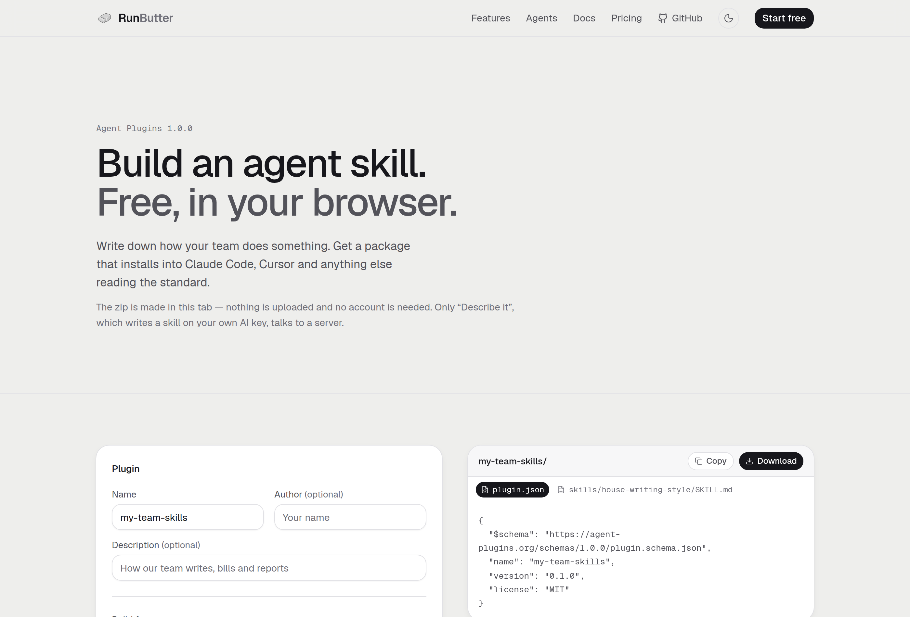</a></td>
</tr>
</table>

## Connect an AI client (MCP)

```json
{ "mcpServers": { "runbutter": {
    "type": "http", "url": "https://your-domain.com/api/mcp",
    "headers": { "Authorization": "Bearer hb_..." } } } }
```

Create the key under **Settings → Integrations**. On claude.ai, add the URL as a
connector and sign in instead — the server speaks OAuth, so there is no key to
paste. The same key works for the REST API (`GET/POST /api/v1/records`) and the
CSV feed Excel reads directly. → [docs/api.md](docs/api.md)

## Stack

Next.js 14 (App Router) · React · Tailwind · Postgres (Supabase or your own) ·
[Privy](https://privy.io) auth · Stripe · Resend. Runs anywhere Node runs.

## Documentation

| | |
|---|---|
| [Install](docs/install.md) | Docker, Supabase + Node, or one SQL file |
| [Configuration](docs/configuration.md) | Every variable and what it switches on |
| [Going live](docs/going-live.md) | Email, billing, secrets, publishing |
| [Updating](docs/updating.md) | New code, then new schema |
| [Architecture](docs/architecture.md) | One database, one door |
| [Custom objects](docs/custom-objects.md) | Track what your business actually has |
| [Agents](docs/agents.md) | Roles, tools, and what bounds them |
| [REST API & MCP](docs/api.md) | Keys, scopes, the CSV feed |
| [Find leads](docs/lead-finder.md) · [Company lookup](docs/company-lookup.md) | Where the data comes from, and what you may do with it |
| [Booking pages](docs/booking.md) · [Time & leave](docs/time.md) | Scheduling, timesheets, time off |
| [Support inbox](docs/support.md) · [Chat widget](docs/chat-widget.md) · [Surveys](docs/surveys.md) | Talking to customers |
| [Scan receipts](docs/receipts.md) · [Files](docs/file-extraction.md) | Documents that become data |
| [Roadmap](docs/roadmap.md) | Shipped, next, and deliberately declined |

## Contributing

Pull requests welcome — [CONTRIBUTING.md](CONTRIBUTING.md) has the conventions,
and a few of them are load-bearing (idempotent migrations, semantic colour
tokens, no metered APIs in core paths).

**A good first contribution:** a workspace template for a trade you know. One
file, no schema change, and the person who actually runs a bakery will do it
better than we would. → [docs/contributing.md](docs/contributing.md)

Found something broken? [Open an issue](https://github.com/RunButter/runbutter/issues).
Found a vulnerability? [SECURITY.md](SECURITY.md) — privately, please.

<!-- docs/images/social-preview.png is for the repository's SOCIAL PREVIEW, set
     in Settings → General → Social preview. GitHub does not read it from the
     tree, so it has to be uploaded by hand — once. Without it, every link to
     this repo posted anywhere renders as a grey box with a filename.

     The screenshots in docs/images/readme/ use made-up data: every company,
     person and number in them is invented. -->

## If this is useful

**Star it.** It is the whole marketing budget. A star is how the next person
looking for "open source CRM I can self-host" finds out this exists, and it
costs you one click.

Then: run it, break it, and [tell us what broke](https://github.com/RunButter/runbutter/issues).
The most useful issue is the one that starts "I tried to do X and".

## Licence

[MIT](LICENSE). Every dependency and data source in here is compatible with
that, and it is checked deliberately: nothing is copied from AGPL or GPL
projects, however good they are.
